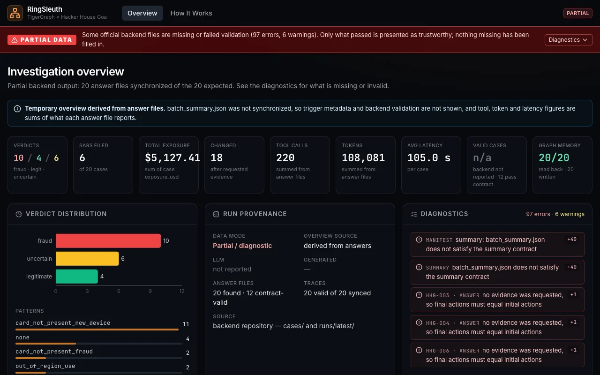
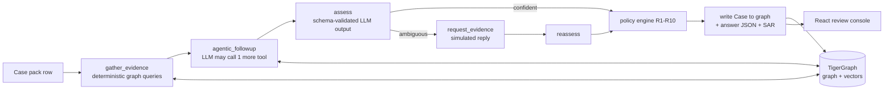

# RingSleuth

**A graph-native fraud investigation agent.** For each flagged card alert, a LangGraph agent
investigates 590k card transactions stored in TigerGraph, retrieves similar closed cases
(GraphRAG), applies a deterministic fraud-policy engine, drafts a suspicious activity report
(SAR) when policy calls for one, and writes the case back into the graph as memory.

Built in about 48 hours for the TigerGraph x Hacker House Goa fraud challenge
(22 to 24 Sep 2026). The original task brief is kept in [docs/TASK.md](docs/TASK.md).

## What it does

- **Graph evidence, not just a score.** Every case starts from graph queries over cards,
  devices, billing regions, email domains and prior closed cases. Risk scores are treated as
  an input, never as the answer.
- **GraphRAG.** Vector search over closed-case narratives, the fraud policy and regulatory
  documents is combined with multi-hop graph traversal.
- **Fraud-ring signal.** Connected Components over a projected "shares origin" edge
  (shared device, region or email) gives every card a ring cluster and a cluster prior
  fraud rate.
- **Policy you can audit.** The LLM never invents actions. A deterministic engine maps
  structured findings to action names, approval routes (auto, L1, L2) and rule citations
  (R1 to R10).
- **Initial vs final action.** The agent can request more evidence (simulated customer or
  analyst replies) and the recommended action may change. The change is recorded per case.
- **Case memory.** Each finished case is written to TigerGraph, embedded and made
  retrievable by later cases in the same run.
- **Review console.** A static React app shows verdict, evidence, retrieved prior cases,
  tool provenance, action changes and the SAR for each case.



## Architecture



## How it works

1. **Load.** GSQL loading jobs bring in 590,742 transactions, 144,432 identity records and
   5,565 closed cases. Derived entities (device profile, email domain, billing region) are
   added after load.
2. **Graph algorithm.** Connected Components runs once over `Card-SHARES_ORIGIN-Card` edges.
   Origin groups with more than 20 cards are excluded to avoid generic-fingerprint noise.
3. **Knowledge ingestion.** The fraud policy, the five documented fraud patterns, regulatory
   text and closed-case narratives are embedded locally (`nomic-embed-text`) and upserted
   through the TigerGraph MCP server.
4. **Investigate (LangGraph).** Seven nodes: gather evidence, bounded agentic follow-up, assess,
   stopping check, request evidence, reassess, policy. Every graph lookup is cut off at the
   case's own opened-at time to prevent temporal leakage.
5. **Decide.** Python encodes the action table, approval routes and rules R1 to R10. The LLM
   only classifies, extracts and writes prose.
6. **Write back.** The case is stored as a `Case` vertex with edges and an embedding, and an
   answer JSON validated by Pydantic schemas is emitted with a full tool trace.

## Results (20-case benchmark run)

Source: `runs/latest/batch_summary.json` and `runs/latest/PROVENANCE.md`.

| Metric | Value |
|---|---|
| Cases completed / valid / written to graph | 20 / 20 / 20 |
| Verdicts | 10 fraud, 4 legitimate, 6 uncertain |
| SARs filed | 6 |
| Cases where the recommended action changed after more evidence | 16 |
| Total exposure identified | $5,127.41 |
| Tool calls / tokens / mean latency | 220 / 108,081 / 105 s per case |

<details><summary>Per-case results</summary>

| Case | Verdict | P(fraud) | Pattern | Exposure | SAR | Action changed |
|---|---|---|---|---|---|---|
| HHG-001 | legitimate | 0.12 | none | $0 | no | no |
| HHG-002 | fraud | 0.99 | none | $292.36 | no | yes |
| HHG-003 | legitimate | 0.15 | account_takeover | $0 | no | yes |
| HHG-004 | fraud | 0.85 | CNP new device | $221.19 | yes | yes |
| HHG-005 | uncertain | 0.32 | CNP new device | $100.07 | no | yes |
| HHG-006 | fraud | 0.92 | CNP new device | $1,906.07 | yes | yes |
| HHG-007 | fraud | 0.87 | none | $111.92 | no | no |
| HHG-008 | legitimate | 0.15 | none | $0 | no | yes |
| HHG-009 | fraud | 0.85 | CNP fraud | $30.02 | no | yes |
| HHG-010 | fraud | 0.88 | CNP new device | $1,000.03 | yes | yes |
| HHG-011 | fraud | 0.88 | CNP new device | $131.30 | yes | no |
| HHG-012 | legitimate | 0.15 | out_of_region_use | $0 | no | no |
| HHG-013 | uncertain | 0.52 | CNP new device | $35.66 | no | yes |
| HHG-014 | uncertain | 0.41 | CNP new device | $74.96 | no | yes |
| HHG-015 | fraud | 0.98 | CNP new device | $599.94 | yes | yes |
| HHG-016 | fraud | 0.85 | CNP new device | $59.67 | no | yes |
| HHG-017 | uncertain | 0.74 | CNP fraud | $300.14 | no | yes |
| HHG-018 | uncertain | 0.95 | out_of_region_use | $39.08 | no | yes |
| HHG-019 | fraud | 0.90 | CNP new device | $99.92 | yes | yes |
| HHG-020 | uncertain | 0.49 | CNP new device | $125.08 | no | yes |

CNP = card-not-present.
</details>

### Read these before quoting the numbers

- **Console validation differs from backend validation.** The committed UI data is marked `partial`: 20 answer files are present, with 12 passing its stricter answer contract. Summary/trace contract diagnostics are also exposed in the console. The backend-reported 20/20 result above does not imply every file passes browser validation. No result files have been altered to hide these discrepancies.

- **No accuracy figure.** The organisers withheld the answer key, so verdicts and actions
  were never scored. The table describes what the agent concluded, not how often it was right.
- **6 of 20 verdicts are "uncertain"**, and two fraud verdicts carry pattern "none".
  HHG-003 and HHG-012 pair a "legitimate" verdict with a non-"none" pattern, a known
  inconsistency in the local-model output.
- **Mixed LLM providers.** Ten cases (HHG-001, 008, 009, 010, 011, 013, 014, 017, 019, 020) were
  produced by a GPT-5.5 run through the Pi harness. The other ten were produced locally with
  Ollama `qwen3:4b-instruct`, after the Groq free tier's daily token quota ran out mid-run.
  Cases were not re-run to fix issues.
- **Simulated customer and analyst replies.** The "more evidence" step uses a rule-based
  simulator against real graph data, recorded as an assumption in each answer.
- **Known limits.** Connected Components runs once after load, not incrementally. The agentic
  follow-up is capped at one extra tool call per case. Regulatory PDF chunking is automated
  text extraction.

## Tech stack

Python 3.10+, TigerGraph Savanna (GSQL, Connected Components, vector search) via
`tigergraph-mcp`, LangGraph, Pydantic v2, pandas, tenacity, Ollama (embeddings and fallback
LLM), Groq or OpenAI-compatible LLM, pytest. Review console: React 18, TypeScript, Vite,
Tailwind, Zod, Vitest.

## Setup and run

The dataset is not included (`transactions.csv`, `identity.csv`, `closed_cases_history.csv`,
`case_pack.csv` are gitignored). Place them in the repo root.

```bash
python -m venv .venv && source .venv/bin/activate
pip install -r requirements.txt
cp .env.example .env          # TigerGraph Savanna credentials + GROQ_API_KEY (or LLM_BACKEND=ollama)
ollama pull nomic-embed-text   # embeddings are always local; also qwen3:4b-instruct for LLM_BACKEND=ollama

python -m scripts.create_schema
python -m scripts.load_data
python -m scripts.derive_entities
python -m scripts.run_connected_components
python -m scripts.ingest_knowledge
python -m scripts.run_batch                       # writes cases/HHG-001..020.json and runs/latest/
python -m src.run.validate_outputs cases          # expect "20/20 files passed."
```

Review console (static browser UI; no live graph or LLM calls):

```bash
cd ui && npm ci && npm run dev   # http://localhost:5173
```

Tests: `pytest`. The handoff reports 142 of 169 backend tests passing offline; the remaining 27 require live services. This is a historical result, not a fresh test run.

## Project structure

```
src/agent/             LangGraph flow, LLM wrapper, simulator, SAR writer, schemas
src/graph/             GSQL query wrappers, vector search
src/graph_algorithms/  Connected Components
src/ingestion/         policy, regulatory-doc and embedding ingestion
src/policy/            deterministic policy engine (R1-R10)
src/schema/            graph schema, loading jobs, derived entities
src/run/               per-case runner, batch runner, validator, trace writer
scripts/               one-time setup and batch entry points
tests/                 pytest suite
cases/                 20 answer files
runs/latest/           batch summary, traces, provenance
ui/                    React review console (reads static JSON only)
docs/                  design doc, plan, runbook, TASK.md (original task brief)
```

## Documentation

- [Original challenge brief and answer contract](docs/TASK.md)
- [Review console setup and data modes](ui/README.md)
- [Backend runbook](docs/TEAMMATE_BATCH_RUN.md)
- [Design](docs/superpowers/specs/2026-09-22-tigergraph-fraud-agent-design.md)
- [Implementation plan](docs/superpowers/plans/2026-09-22-tigergraph-fraud-agent-plan.md)
